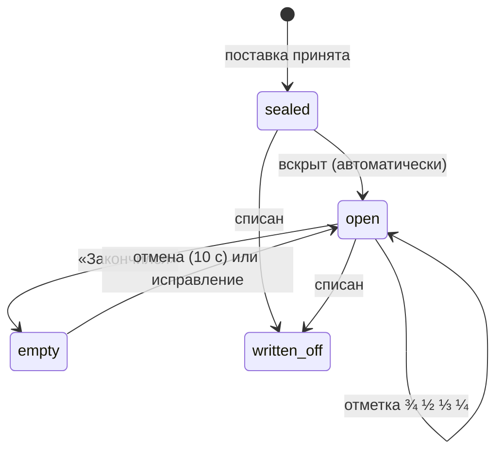

# Handoff: Инвентарь — поставки, контейнеры, расход (#152)

Мокап и анализ сделаны по скиллу `atelier-feature-design`. Заменяет черновик #152
(«инвентаризация по объёмам»): после разговора с мастером стало понятно, что учёт идёт
не в граммах, а контейнерами по счетам поставщиков.

Статус: **вопросы закрыты (2026-10-19), мокап на согласовании владельцем.** Код не пишется,
пока мокап не согласован.

## Как открыть

```bash
python3 -m http.server 8765 --bind 127.0.0.1
```

Затем `http://localhost:8765/design/design_handoff_inventory/mockups.html`.

- Доска: сверху кликабельный прототип «Мастера» (вкладки «Полка», «Поставки», «Каталог», «Дашборд»;
  «Закончился» и отмена, меню «⋯», карточка по клику на строку, «Загрузить счёт» → разбор),
  ниже — все экраны и края.
- `mockups.html#shot=<id>` — один экран без доски (десктоп 1280×800 или 1280×980, телефон 375×780).
  `id` — в разделе 7.
- `screens/` — снимки ключевых экранов (`<id>.png`).

## Файлы

- `mockups.html` — оболочка, классы «Мастера» из `ui_kits/master/index.html` и новые `.inv-*`, `.m-*`.
- `board.jsx` — экраны на примитивах кита (`MasterTopBar`, `MasterPageHeader`, `MasterStatsRow`,
  `MasterList`, `FilterChip`, `MasterTag`, `MasterButton`…) и доска.
- `inventory-data.js` — табаки и миксы прода на 19.10.2026 (`/guest/mixer/palette`,
  `/guest/catalog/mixes`), строки счёта — дословно из реального счёта. Мокап показывает полку
  через месяц после запуска («сегодня» 19 ноября). Поставщики, номера счетов и цифры htreviews
  вымышлены: реквизиты и закупки клиента в публичный репозиторий не кладём.

## Решения по вопросам (2026-10-19)

1. **Термин — «контейнер»** везде: в интерфейсе («Закончился», «1 + 2», «Последний контейнер»)
   и в коде (`Container`). Покрывает и банки 200–250 г, и пачки 25 г.
2. **Отметка мастера — минимум:** «Закончился» одним нажатием. Остаток ¾ ½ ⅓ ¼ — по желанию.
3. **Приход — загрузкой PDF счёта.** Разбор — под два формата счетов, которые есть сейчас (§5),
   без LLM и внешних сервисов. Новый формат — «Заполнить вручную» и issue на доработку разбора.
4. **Деньги храним:** поставщик, номер и дата счёта, цена за контейнер.
5. **Одна точка.** Сеть — отдельная фича.
6. **Стоп для гостей нужен** — тумблер на полке, заменяет нынешний тумблер наличия.
7. **Старт на проде — «как будто контейнеры только пришли»** (§8). Режим пересчёта не нужен.
8. **Граммовка чаши — 18 г, срок поставки — 7 дней**, оба настраиваются (настройки полки, §7).
9. **Telegram-бот не нужен**, хватит «Полки» на телефоне.
10. **Тестовые счета:** в репозиторий — синтетические текстовые фикстуры в вёрстке двух форматов
    с вымышленными поставщиками, ИНН и реквизитами. Настоящие PDF не коммитим.

## 1. Как сейчас

- **Процесс точки.** Наличие ведётся в Excel: лист «бренд → вкусы», без количеств и дат.
  Табак приходит партиями по счёту поставщика: 9–15 строк, по 1–2 штуки на вкус,
  фасовка 25/200/250 г, цена за штуку, артикул поставщика (не у всех). Названия
  в счёте транслитерированы и не совпадают с каталогом: «"Дарк Сайд" Кор (Блэккерент), 250 г»,
  «Black Burn 200г Raspberries (Спелая лесная малина)». В счёте бывают позиции, которые
  не табак (бестабачная смесь, уголь).
- **Счёт ≠ приход.** Это счёт на оплату: товар отгружают после оплаты, и состав может
  отличаться. Дата счёта и дата прихода — разные даты.
- **Модель данных.** Наличие — флаг `Tobacco.inStock` прямо на карточке каталога htreviews.
  Каталог и наличие — одна сущность. PRD §5.2 обещал отдельный `InventoryItem`, но его
  так и не сделали.
- **Интерфейс.** «Табаки» в «Мастере» — таблица каталога (~11,5 тыс. карточек) с серверной
  пагинацией и debounce-поиском, а на полке точки 269 табаков. Мастер ищет иголку в стоге:
  каждый фильтр — запрос к серверу, наличие — тумблер без истории.
- **htreviews.** Парсер уже достаёт `rating`, `ratingsCount`, `reviewsCount`, `viewsCount`,
  но в БД они не сохраняются.

## 2. Сущности

Язык предметной области (UI и код):

| Термин | Сущность | Что это | Откуда |
|---|---|---|---|
| **Каталог** | `Tobacco` (есть) | Какие табаки вообще бывают: карточки htreviews и свои. Ничего не знает о наличии. | синхронизация htreviews, ручное создание |
| **Полка** | `ShelfItem` (новая) | Табак, который точка держит. Одна запись на табак: фасовка по умолчанию, «держим постоянно», стоп для гостей, заметка. Термин «полка» уже живёт в коде миксера (#183, #196). | приход, «Добавить из каталога», «В план» из идей |
| **Контейнер** | `Container` (новая) | Физическая единица на полке со своим жизненным циклом: банка 200–250 г или пачка 25 г. | приход по счёту, старт (§8) |
| **Отметка** | `ContainerMark` (новая) | Точка на шкале контейнера: «осталось ½» в момент t. Из них считается расход. | мастер, по желанию |
| **Поставка** | `Delivery` + `DeliveryLine` (новые) | Загруженный счёт: поставщик, номер, дата счёта, дата прихода, строки с ценой, файл PDF. | загрузка PDF |
| **Поставщик** | `Supplier` (новая) | Название, ИНН, формат счёта. | из счёта |
| **Артикул поставщика** | `SupplierItem` (новая) | Память сопоставлений «строка счёта поставщика → табак каталога + фасовка». Второй счёт того же поставщика сопоставляется сам. | подтверждение строки при приёмке |
| **Настройки полки** | `ShelfSettings` (новая, одна строка) | Граммовка чаши (18 г), срок поставки (7 дней). | «Полка» → «⋯» → «Настройки полки» |

```text
Supplier 1─* Delivery 1─* DeliveryLine *─1 Tobacco
Supplier 1─* SupplierItem *─1 Tobacco
Tobacco 1─0..1 ShelfItem 1─* Container 1─* ContainerMark
DeliveryLine 1─* Container         (строка «×2» даёт два контейнера)
```

Одна точка: у `ShelfItem` нет `locationId`. Сеть — отдельная фича: тогда `ShelfItem`, `Delivery`
и `ShelfSettings` получат точку, а каталог, миксы и артикулы останутся общими.

## 3. Жизненный цикл

### Контейнер



- **В запасе** (`sealed`) — пришёл, закрыт.
- **В работе** (`open`) — вскрыт. Мастер вскрытие **не отмечает**. Если у табака нет контейнера
  в работе, самый старый из запаса становится открытым в момент прихода или в момент, когда
  закончился предыдущий. Вскрыть второй параллельно можно из меню строки (редкий случай).
- **Отметки** — по желанию: «осталось ¾ / ½ / ⅓ / ¼» одним касанием. Отметка уточняет
  расход и прогноз текущего контейнера, но без неё всё работает.
- **Пустой** (`empty`) — одно касание «Закончился». Отмена — 10 секунд в тосте, потом
  через историю контейнера.
- **Списан** (`written_off`) — брак, пересорт, потеря. В расход не идёт.

### Табак на полке

Статус выводится из контейнеров, руками ставится только стоп:

| Статус | Условие | Гость видит |
|---|---|---|
| Есть | есть контейнер в работе и запас | да |
| Последний контейнер | в работе один, запаса нет | да |
| Заканчивается | прогноз «хватит» ≤ срока поставки (7 дней) | да |
| Закончился | контейнеров нет, «держим постоянно» | нет, попадает в «К заказу» |
| Стоп | контейнеры есть, мастер включил «стоп для гостей» | нет |
| В плане | добавлен из идей или каталога, контейнеров ещё не было | нет, попадает в «К заказу» |
| Не держим | убран с полки; история остаётся | нет |

**Наличие для гостя:** `в наличии = есть контейнер sealed или open И не стоп И не архив`.
Это уточняет инвариант CLAUDE.md §7.3, а не меняет его. `Tobacco.inStock` остаётся
кэшем, который пишет только модуль инвентаря в той же транзакции, что меняет контейнеры.
Рекомендации, миксер и каталог гостя не трогаем вообще.

### Табак целиком

```text
каталог htreviews ──► идея закупки ──► строка счёта ──► контейнер в запасе ──► в работе
      ▲                (Идеи)          (Поставки)            (Полка)               │ отметки
      │                                                                            ▼
  «В план» ◄── «К заказу» ◄── прогноз «хватит до» ◄── расход г/день ◄── пустой
```

## 4. Расход и прогноз

Шкала контейнера — точки `(t, f)`, где `f` — доля остатка: вскрытие `(opened, 1)`, отметки
`(t_i, f_i)`, «Закончился» `(emptied, 0)`. Для отрезка между соседними точками:
`граммы = вес × (f_{i-1} − f_i)`, `дни = t_i − t_{i-1}`.

- **Расход табака, г/день** — сумма граммов, делённая на сумму дней по отрезкам за 60 дней.
- **Доверие:**
  - «мало данных» — пока нет ни одного пустого контейнера и ни одной пары отметок;
  - тогда подставляется медиана расхода по бренду на полке с пометкой «оценка по бренду».
- **Остаток открытого контейнера сейчас:**
  - от последней отметки: `вес × f_last − расход × (сейчас − t_last)`;
  - если отметок нет — от вскрытия;
  - если вышло меньше 10 % веса — «должен был закончиться — проверьте». Это мягкий запрос
    отметки, а не ошибка.
- **Хватит до** = сегодня + `(остаток + граммы в запасе) / расход`.
- **Прогноз на сегодня** = сумма расходов всех табаков в работе, г. В чашах — делим на
  граммовку чаши из настроек.
- **День недели.** По контейнерам его не восстановить: один контейнер живёт 1–3 недели.
  Поправку на день недели даёт доля «Покурить» по дням недели (`SmokeCtaEvent`, только
  аналитика, инвариант §7.2), когда накопится 4+ недели. До этого прогноз без поправки,
  и UI так и пишет.
- **Деньги:**
  - цена грамма = цена контейнера / вес;
  - себестоимость чаши ≈ граммовка × средняя цена грамма табаков в работе;
  - траты по поставщикам за месяц.
- **К заказу** — табаки «держим постоянно» и «в плане», у которых «хватит до» ≤ сегодня
  + срок поставки (или контейнеров нет). Предлагаемое количество = `ceil(расход × 21 день / вес)`,
  минимум 1. Группировка по последнему поставщику, рядом последняя цена. «Скопировать заказ» —
  текст для чата с поставщиком.

Вся математика — чистые функции в `apps/backend/src/stock.ts`, тестируются без БД (TDD).

## 5. Поставка из PDF

1. **Загрузка.** Мастер перетаскивает PDF на «Поставки» или жмёт «Загрузить счёт». Файл
   хранится при поставке.
2. **Текст.** Текстовый слой PDF извлекается на backend (`pdfjs-dist`, без внешних сервисов).
   Нет текста (скан, фото) — «Заполнить вручную».
3. **Формат счёта** определяется по шапке. Сейчас их два:
   - **«Счёт на оплату» с колонкой «Артикул»** — № · Артикул · Товары · Количество · ед. · Цена · Сумма;
     «Итого», «В т.ч. НДС».
   - **«СЧЕТ №» без артикула** — № · Наименование · Цена · Кол-во · Ед. изм. · Сумма;
     наименование переносится на 2–3 строки.

   Каждый формат — отдельная функция разбора текста в строки (название, артикул, кол-во,
   цена, сумма) + поставщик, ИНН, номер, дата, итог. Формат не узнан — «Заполнить вручную»
   и issue на третий формат.
4. **Проверка на границе системы:** сумма строк = «Итого». Не сошлось — предупреждение,
   приёмку не блокирует.
5. **Сопоставление строки с каталогом**, по порядку:
   1. `SupplierItem` по (поставщик, артикул) или нормализованному названию — «по памяти»;
   2. кандидаты из каталога: словарь брендов («Дарк Сайд» → DARKSIDE, «Старлайн» → Starline,
      «ХЛГН» → Хулиган), транслит, линейка, вкус — «предложение» с уверенностью;
   3. ничего — «не найдено»: поиск по каталогу или «Создать карточку».
   - Строки «не табак» распознаются по отсутствию бренда и веса, их можно пропустить.
6. **Фасовка** — из названия («250 г», «200гр», «25г»), иначе фасовка по умолчанию с полки.
7. **Приёмка.** Переключатель «пришло» и количество на каждой строке (счёт ≠ приход), дата прихода.
   «Принять поставку» создаёт контейнеры, запоминает сопоставления в `SupplierItem`, ставит
   новые табаки на полку. Повторная загрузка того же номера от того же поставщика — предупреждение
   о дубликате.
8. **Черновик** живёт, пока товар не пришёл: счёт загрузили в день оплаты, приняли в день прихода.

Тесты разбора — на синтетических текстовых фикстурах обоих форматов (решение 10).

## 6. Идеи из htreviews

- Синхронизация начинает сохранять `rating`, `ratingsCount`, `reviewsCount`, `viewsCount`
  и `statsSyncedAt` на `Tobacco`. Свежесть — с частотой текущей синхронизации, нового обхода
  сайта нет.
- «Каталог → Идеи» — табаки, которых нет на полке, в трёх подборках:
  - **Популярное у ваших брендов** — бренды полки по просмотрам;
  - **Высокий рейтинг** — байесовская оценка
    `(rating × n + 4,2 × 50) / (n + 50)`, чтобы 5,0 с тремя оценками не обгоняло 4,7 с тысячей;
  - **Похоже на то, что быстро уходит** — вкусы и профили топ-10 по расходу.
- Карточка идеи: рейтинг, число оценок, просмотры, профили, «Открыть на htreviews ↗»
  (`sourceUrl`), «В план». Функционал htreviews (отзывы, обсуждения) не переносим.

## 7. Экраны

Навигация «Мастера»: Дашборд · **Полка** · **Поставки** · **Каталог** · Миксы · Рейлы · Доступ.
Вкладка «Табаки» делится на «Полку» (269 позиций, работает в браузере без запросов на каждый
фильтр) и «Каталог» (11,5 тыс., серверная пагинация как сейчас).

| id | Экран | Суть |
|---|---|---|
| `shelf` | Полка | KPI, статусы-чипы со счётчиками, контейнеры-пипсы, остаток, расход, «хватит до» со статусом, «Закончился» и «⋯» в строке |
| `shelf-filters` | Полка, фильтры | бренд, характер, крепость, поставщик, «в миксах», «мало данных» — всё в браузере |
| `shelf-menu` | Меню строки | отметка ¾ ½ ⅓ ¼, вскрыть ещё один, добавить вручную, стоп, списать, убрать с полки |
| `shelf-undo` | «Закончился» + отмена | гость сразу перестаёт видеть табак, миксы скрыты, табак в «К заказу», 10 с на отмену |
| `shelf-drawer` | Карточка на полке | прогноз, остаток, расход, цена грамма и чаши, история контейнеров, расход по контейнерам, настройки, миксы |
| `reorder` | К заказу | группы по поставщику, «хватит до», количество, последняя цена, «Скопировать заказ» |
| `shelf-mobile` | Полка, 375 px | карточки с большой «Закончился», чипы статусов |
| `shelf-mobile-sheet` | Шторка «Сколько осталось?» | 1 ¾ ½ ⅓ ¼ и «Закончился» |
| `deliveries` | Поставки | KPI месяца, перетаскивание PDF, счета, черновик ждёт прихода |
| `delivery-parse` | Разбор счёта | память, предложения с уверенностью, «нет в каталоге» → создать карточку, «не табак», фасовка 25 г, ×2, «пришло», сверка суммы, блокировка приёмки до выбора табака |
| `ideas` | Каталог → Идеи | три подборки: рейтинг, оценки, просмотры, ссылка на htreviews, «В план» |
| `catalog-all` | Каталог → Все табаки | каталог отдельно от полки, колонки htreviews, «В план» |
| `dashboard` | Дашборд | прогноз на сегодня, что заканчивается, траты по поставщикам, себестоимость чаши, расход по неделям |
| `edge-empty` | Пустая полка | первый запуск: «Загрузить счёт» или «Добавить из каталога» |
| `edge-few` | Мало данных | прогноз по бренду, пока нет своего пустого контейнера |
| `edge-pdf` | PDF без текста | скан или фото → «Заполнить вручную» |
| `edge-dup` | Счёт уже загружен | второй раз контейнеры не создаём |
| `edge-sum` | Сумма не сходится | предупреждение, приёмку не блокирует |

Клавиатура на полке: `/` — поиск, `↑↓` — строка, `Enter` — карточка, `E` — «Закончился»,
`1–4` — отметка ¾ ½ ⅓ ¼, `Z` — отменить последнее.

**Настройки полки** — простая форма из двух полей (граммовка чаши, срок поставки) в меню
«⋯» шапки «Полки». Отдельно не мокапится: поля `MasterInput` и «Сохранить».

## 8. Старт на проде

- Каждому из 269 табаков с `inStock = true` создаётся `ShelfItem` и один **полный** контейнер,
  как будто он пришёл в день запуска: статус `open`, `receivedAt = openedAt = дата миграции`,
  поставка «Стартовый приход» без поставщика и цены, вес — по типичной фасовке бренда
  (DARKSIDE 250 г, Black Burn / Sebero / Сарма 200 г…), мастер поправит в карточке.
- Расход по стартовым контейнерам считается как по обычным. Они были вскрыты раньше,
  поэтому первый расход выйдет завышенным, а прогноз «хватит до» — осторожным. Со второго
  контейнера данные честные. Отметка ¾ ½ ⅓ ¼ на стартовом контейнере исправляет это сразу.
- Табаки с `inStock = false` на полку не попадают: их добавят поставкой или из каталога.
- `ShelfSettings` заполняется значениями по умолчанию: 18 г, 7 дней.
- Снапшоты `snapshots/*.dump` пересобрать и проверить рестор в чистую БД.

## 9. Продуктовые инварианты (atelier-product-guardrails)

| Инвариант | Влияние | Вывод |
|---|---|---|
| §7.1 гость без авторизации | не затрагивается | ok |
| §7.2 «Покурить» — аналитика | используется только как сигнал дня недели, автосписания нет | ok |
| §7.3 рекомендации от наличия | семантика наличия уточняется: из контейнеров и стопа | **нужна правка PRD** §5.2, §9.3, §9.4 до схемы |
| §7.4 таксономия | не затрагивается | ok |

Метка: `needs clarification` → отдельный PR в `PRD.md` (process, human review) первым срезом.

## 10. Нарезка (после согласования мокапа)

| # | Срез | Поверхности | Ревью | Зависит |
|---|---|---|---|---|
| 0 | PRD: наличие из контейнеров и стопа, сущности полки и поставки | `PRD.md`, `CLAUDE.md` §7 | human | — |
| 1 | Схема полки и контейнеров + `ShelfSettings` + старт из `inStock` + `stock.ts` (расход, прогноз) | backend, prisma | human | 0 |
| 2 | Полка: API и экран (десктоп): статусы, фильтры, «Закончился», отметки, стоп, отмена, карточка | backend, master-web, smoke | self | 1 |
| 3 | Поставки: PDF → разбор двух форматов → сопоставление → приёмка, `SupplierItem` | backend, prisma, master-web, smoke | human (схема) | 1 |
| 4 | Прогноз и «К заказу», настройки полки, блок дашборда | backend, master-web | self | 2 |
| 5 | htreviews: статистика в каталоге и «Идеи» | backend, prisma, master-web | human (схема) | 0 |
| 6 | Полка на телефоне (375 px) | master-web, smoke | self | 2 |

Срез 5 идёт параллельно с 1–4: другие таблицы и экраны. Остальные срезы — последовательно,
у них общий модуль инвентаря.

## Что не делаем

- Автосписание по «Покурить» и учёт граммов за чашу.
- Несколько точек, перемещения между точками.
- Бухгалтерию: оплаты, НДС, УПД, интеграцию с 1С.
- Перенос функционала htreviews (отзывы, обсуждения): только цифры и ссылка.
- LLM-разбор счетов и форматы сверх двух текущих — по мере появления новых поставщиков.
- Фото и сканы счетов (OCR) — только PDF с текстовым слоем; скан → ручной ввод строк.
- Отметки из Telegram-бота.
- Режим первичного пересчёта полки.
